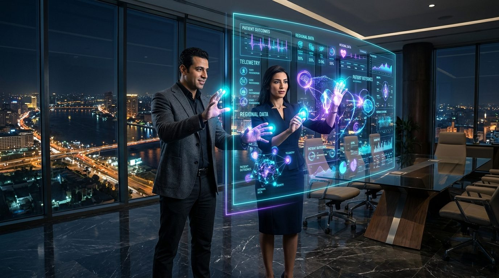

# 💎 Holographic Clinical Command Deck
### Sovereign Analytics Intelligence • 60FPS Glassmorphic Clinical Dashboard & Companion Excel Suite

[](https://mth1346686.github.io/holographic-command-deck/)
[](LICENSE)
[]()
[]()

---

## 🌐 Live URL
Access the live interactive command deck directly on GitHub Pages:
**[https://mth1346686.github.io/holographic-command-deck/](https://mth1346686.github.io/holographic-command-deck/)**

---

## 📸 Executive Boardroom Preview


---

## 🌟 Key Architectural Pillars

### 1. 60FPS Scroll & Motion Dynamics
• IntersectionObserver 3D Holographic Staggered Reveal with blur-to-focus depth and laser light sheen sweeps.
• Dynamic SVG Ingress Drawing: Spline paths draw continuously across the horizon, grouped bars elevate dynamically from base, and scatter matrix bubbles burst with spring-pop physics.
• Smooth CountUp Numerical Telemetry rolling up metrics upon first entry into the viewport.
• Top Holographic Laser Scroll Progress Bar (0% to 100%) tracking navigation depth.
• Floating HUD Depth Capsule with real-time level indicators and instant glide-to-top navigation.
• Interactive 3D Perspective Tilt responding dynamically to cursor position and mobile touch gestures.
• Ambient Cyber Dust 60FPS Canvas reacting proportionally to scroll velocity.
• Built-in Web Audio API Glass Crystal Sonic Feedback (toggleable on/off).

### 2. Comprehensive Analytics Hierarchy
• Descriptive Analytics: Real-time operational admissions, patient flow, and bed occupancy rates.
• Diagnostic Analytics: Departmental cost-to-stay scatter matrices and variance waterfall bridges.
• Predictive Analytics: 90-Day ARIMA occupancy forecasting with 95% statistical confidence intervals.
• Prescriptive Analytics: AI actionable directives for bed re-allocation and surgical block optimization.
• Interactive What-If Capacity Simulator: Real-time slider adjustments computing projected monthly revenue (EGP) and bed headroom.

### 3. Authentic Regional Financials
• Native Egyptian Pound currency (EGP / L.E) with realistic multi-branch private hospital metrics (New Cairo, Sheikh Zayed, Mohandessin, Alexandria).
• Real clinical workflow KPIs (Average Length of Stay, Bed Turnover Interval, Patient Satisfaction CSAT).

### 4. Executive Single-Page Excel Companion
• Included binary workbook: `Holographic_Clinical_Analytics.xlsx`
• Strict A:R column bounded layout for zero horizontal scroll.
• Dark Luxury cyber palette with frozen executive panes and isolated calculation engines.

---

## 📁 Repository Structure
• `index.html`: Complete standalone 60FPS holographic glass dashboard.
• `Holographic_Clinical_Analytics.xlsx`: Executive companion single-page workbook.
• `cairo_tech_founders_hologram.jpg`: 8K cinematic editorial preview photograph.
• `cairo_holographic_glass_boardroom.jpg`: High-resolution boardroom environment photograph.
• `README.md`: Documentation and architectural overview.

---

## 🚀 Local Execution
To run locally, simply open `index.html` in any modern web browser or serve with:
```bash
python3 -m http.server 8080
```
Then navigate to `http://localhost:8080`.

---

### Built with Sovereign Century Swarm Architecture & Co-Piloted by Agent 101 ('يويا')
